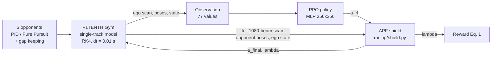

# Architecture

Every number below is the value in the code on this branch. File references are relative to the repo root.

## Control loop

- Physics step 0.01 s (RK4), control step 0.04 s (25 Hz); the action is held for 4 physics steps.
- The shield is part of the environment wrapper, so the policy and shield are independent and the shield can be
  switched off (`ShieldConfig(mode="off")`) without touching the policy.

## Simulator layer (`racing/sim.py`, `racing/tires.py`)

- **F1TENTH Gym v1.0** (`f1tenth_gym @ v1.0.0`), dynamic single-track model, default vehicle parameters
  (mass 3.74 kg, wheelbase 0.33 m, mu = 1.0489, steering limit 0.4189 rad, speed limit 20 m/s, a_max 9.51 m/s^2).
- **Map:** `maps/Singapore`, 0.05 m/pixel, generated by `racing/track_gen.py` (corner list with fillet radii).
- **Speed patches:** upstream ray-casts every car into every lidar on every physics step and, for cars behind the
  lidar, loops over all 1080 beams. We skip cars behind / out of range, ray-cast cars into the ego scan only on the
  last physics step of a control step, and update opponent scans once per control step (~10x faster).
- **Tyres** (`tire="saturated"`, default): same CommonRoad single-track equations, rewritten with slip angles, with
  each axle's lateral force capped by a friction circle,
  `|Fy| <= sqrt((mu Fz)^2 - (Fz a / g)^2)`. Identical to stock below the limit (tested). `tire="linear"` is stock.
- **Traction control** (`tcs=True`, all cars): longitudinal acceleration from the speed loop is clamped to
  `sqrt((0.95 mu g)^2 - (v * yaw_rate)^2)` (minimum 0.5 m/s^2). Above 15 deg body slip the car is already sliding
  and full braking is allowed.

## Environment (`racing/env.py`)

**Observation (77 values):**

| part | size | scaling |
|---|---|---|
| lidar, 1080 beams min-pooled into 60 sectors | 60 | clipped at 10 m, / 10 |
| speed, yaw rate, steering angle | 3 | / 10, / 5, / 0.4189 |
| lateral offset from centerline, heading error | 2 | / 1.4, / pi |
| 2 nearest opponents: relative x, y, relative vx, vy (ego frame), present flag | 10 | / 10 |
| previous (post-shield) action | 2 | normalised |

Optional `curvature_preview=True` adds 10 centerline curvatures 1-20 m ahead (not used in the main runs).

**Action:** 2 values in [-1, 1] -> steering = a0 * 0.4189 rad, target speed = 1 + (a1 + 1) / 2 * 15 m/s.

**Reward per control step (Eq. 1):**
`r = 0.002 v_par + 0.1 ds + 2.0 * 1_pass - 0.1 * lambda - 10 * 1_collision`
(v_par speed along the track, ds centerline progress in m, 1_pass a pass held 2 s without contact).

**Episodes:** fixed 40 s (so more distance = more reward), terminated on any ego collision (wall or car),
truncated if the car makes < 1 m progress in 5 s.

**Opponents:** alternate PID (curvature feed-forward + PID on cross-track error + heading term; kp 0.3, ki 0.05,
kd 0, k_head 0.6) and Pure Pursuit (lookahead 0.8 + 0.25 v m). Each drives a fixed fraction of a grip-limited speed
profile (0.85 mu g on curvature, 6 m/s^2 accel/brake passes). Gap keeping: if any car is ahead within
`1 + 0.6 v` m and within 0.7 m laterally, speed <= `v_ahead + 1.5 (gap - 1)`.

**Domain randomisation** (`randomize=True`): friction x U(0.85, 1.15) per episode for all cars, lidar noise
sigma ~ U(0, 0.05) m on the ego scan.

**Curriculum** (`racing/train.py`): stage 1 solo, random start (1.5M steps); stage 2 three opponents at 0.45-0.6 of
the profile (1M); stage 3 opponents at 0.5-0.85 with random grid gaps (1M). Stage 4 (fine-tuning only, E22):
opponents at 0.45-0.8, half the episodes start from rest just before the chicane (`hotspot_prob` 0.5).

## Shield (`racing/shield.py`, `racing/predict.py`)

### APF field (used by every variant)
For each lidar beam i at angle theta_i with range r_i:
- clearance `c_i = r_i - body(theta_i)` (distance from the car outline, not the centre),
- influence distance `d0_i = d_min + max(v cos theta_i, 0)^2 / (2 a_b)` (braking distance on the closing speed),
- risk `rho_i = clip((d0_i - c_i) / (d0_i - d_crit), 0, 1)`, force `F = -sum rho_i^2 dtheta (cos theta_i, sin theta_i)`.

Opponents add an elliptical field stretched along their heading (semi-axes car length + 0.6 m, car width + 0.15 m),
so more room is kept ahead/behind than beside. The lateral force becomes a steering correction (`k_steer F_y`), the
backward force a speed reduction (`-v clip(k_speed max(-F_x, 0))`).

`a_b` is the braking deceleration: `reach="fixed"` uses 6 m/s^2; `reach="grip"` uses what the friction circle leaves
after cornering, `sqrt((mu g)^2 - (v yaw_rate)^2)`, clipped to [1, a_max].

### Variants

| mode | decision | final action | lambda |
|---|---|---|---|
| `additive` | always on (proposal Eq. 2/3) | `clip(a_rl + w a_apf)`, EMA-smoothed | `w = max_i rho_i` |
| `conditioned` | intervene only if the policy's action is predicted unsafe | smallest blend toward the APF-corrected braking action that is predicted safe | blend weight |
| `conditioned_fallback` | as above | if no blend is safe: replace with the backup manoeuvre (or the safest braking manoeuvre) | 1 |

**"Predicted unsafe"** (`racing/predict.py`, numba): from the current exact state, hold the candidate action for one
control step (0.04 s), then run a backup manoeuvre: target speed 0 (traction control sets the deceleration, or
6 m/s^2 for `reach="fixed"`) while Pure Pursuit holds the current lane (1.2 m lookahead), until stopped or 3 s. The
rollout uses the simulator's own model: same ODE, RK4 at 0.01 s, steering servo with its 2-step delay, speed loop,
traction control (verified against the simulator to < 2 cm in `tests/test_predictor.py`). A rollout is unsafe if
- the car's 3 covering circles come within 0.05 m of a static point (lidar every 3rd beam, minus returns within
  0.5 m of an opponent, plus the known track walls from the map, because opponents occlude the lidar), or
- they come within 0.05 m of an opponent, predicted with constant curvature while braking at 6 m/s^2 (worst case), or
- body slip exceeds 20 deg (loss of control).

Blend levels lambda in {0.25, 0.5, 0.75, 1}; corrected action = (steer + APF steering, min(speed + APF speed, 0)).
The fallback tries the backup manoeuvre first (keeps the check recursively feasible), then 7 fixed-steer braking
manoeuvres, picking the largest predicted clearance.

## Training (`racing/train.py`)

SB3 PPO, MLP [256, 256], lr 3e-4, 7 parallel envs x 512 steps per update, batch 1024, 10 epochs, gamma 0.99,
GAE 0.95, clip 0.2, initial log-std -0.5, reward normalisation (`VecNormalize`, no observation normalisation).
Every 50k steps: one solo lap with the shield and one with the shield removed (`eval_log.csv`). Provenance (git
commit, uncommitted changes, command, status) is written to `runs/<run>/run_info.json`.

## Evaluation (`racing/evaluate.py`)

20 shared race seeds (10000-10019; `--first 20 --races 30` adds 10020-10049 for the 50-race head-to-head,
E25); each race: ego from s = 3 m, 3 opponents at random gaps (5-15 m apart) and speeds (0.5-0.75 of
the profile), 5 laps, DNF on the first collision; once nominal and once randomised. Metrics: clean-lap mean / best
(laps 2-5), collisions per 10 laps (wall / car), overtake success (attempt = within 3 m behind, closing, moving
>= 0.3 m off the opponent's line; success = > 1 car length ahead for 2 s without contact), shield frequency and
mean lambda, g-g utilisation from the true velocity-vector acceleration, share of time above 15 deg body slip.
`scripts/analyze.py` merges result files, checks the targets and runs Mann-Whitney U tests on per-race values;
`scripts/headtohead.py` pools the 50 races with Wilson intervals and Fisher's exact tests.

## Configuration reference

`EnvConfig` (`racing/env.py`):

| field | default | meaning |
|---|---|---|
| `n_opp` | 3 | number of opponents |
| `opp_speed` | (0.55, 0.8) | opponent speed range, fraction of the grip-limited profile |
| `opp_types` | ("pid", "pp") | opponent controllers, assigned alternately |
| `random_start` | False | random ego start position and opponent gaps |
| `ego_v_min`, `ego_v_max` | 1.0, 16.0 | target-speed action range (m/s) |
| `phys_dt`, `control_dt` | 0.01, 0.04 | physics and control step (s) |
| `episode_time` | 40.0 | fixed episode length (s) |
| `randomize`, `mu_range`, `lidar_noise` | False, (0.85, 1.15), (0, 0.05) | domain randomisation |
| `w1_speed` ... `w5_pass` | 0.002, 0.1, 0.1, 10, 2 | reward weights (Eq. 1) |
| `shield` | `ShieldConfig()` | see below |
| `shield_prob` | 1.0 | probability the shield is on in an episode (shield dropout) |
| `curvature_preview` | False | add 10 centerline curvatures 1-20 m ahead to the observation |
| `residual`, `residual_scale` | False, 0.3 | ResRace-style: action = PID+APF base + scale x policy |
| `base_mu` | "true" | friction the classical base controllers (residual base, stall recovery, PID+APF / Pure Pursuit baselines) plan their speed profile with: `true` = the simulator's actual friction (privileged; every result before E39), `nominal`, or `estimate` = the shield's online estimate (E39, PROGRESS 44) |
| `tcs` | True | traction control on all cars |
| `tire` | "saturated" | "saturated" (friction circle), "saturated_v2" (+ post-spin slip-angle fixes, used for the final comparison) or "linear" (stock F1TENTH) |
| `w6_slip` | 0.0 | optional penalty per step for body slip beyond 0.15 rad |
| `recover`, `recover_window`, `recover_dist`, `recover_hdg` | False, 1.5 s, 0.3 m, 0.35 rad | stall recovery trigger (E21) |
| `recover_rev_time`, `recover_fwd_time` | 1.5 s, 1.0 s | reverse phase, then centerline-following phase |
| `hotspot_prob`, `hotspot_s`, `hotspot_d`, `hotspot_hdg` | 0.0, (55, 90) m, 0.6 m, 0.3 rad | fine-tuning starts before the chicane (stage 4, E22) |

`ShieldConfig` (`racing/shield.py`): `mode` (off / additive / conditioned / conditioned_fallback), `reach`
(fixed / grip), `a_brake_fixed` 6.0, `d_min` 0.30, `d_crit` 0.05, `k_steer` 2.0, `k_speed` 2.0, `opp_a` 0.6,
`opp_b` 0.15, `smooth` 0.5, `c_safe` 0.05, `commit_time` 0.04, `max_pred_time` 3.0, `blend_levels`
(0.25, 0.5, 0.75, 1.0), `beam_stride` 3, `beta_max` 0.35, `use_map` True, `backup_lookahead` 1.2, `opp_brake` 6.0, `escape` False (deadlock escape, E19), `escape_tol` 0.02, `escape_v` 0.5,
`allow_reverse` False (let negative target speeds through; used by the stall recovery), `c_safe_v` 0 (extra
margin per m/s), `mu_scale` 1.0 (friction the predictor assumes, fraction of nominal; E24).

`python -m racing.train` flags: `--shield {off, additive, cond_fb_grip, cond_fb_fixed, cond_fb_grip_esc}`, `--w6`, `--stages`, `--steps`
(per stage), `--seed`, `--n_envs`, `--n_steps`, `--batch`, `--lr`, `--gamma`, `--ent`, `--eval_every`, `--tire`,
`--no_randomize`, `--curvature_preview`, `--residual`, `--w3`, `--shield_prob p1 p2 p3`, `--init <model.zip>`
(fine-tune from a checkpoint), `--out`.

`python -m racing.evaluate` flags: `--controllers` (pure_pursuit, pid_apf, ppo, ppo_apf, ppo_residual,
ppo_residual_apf, ppo_additive, ppo_apf_esc, ppo_residual_apf_esc, ppo_apf_rec, ppo_residual_apf_rec, and the E24 variants ppo_apf_rec_m1 / _m2 / _b25 / _b18 / _b25mu; append `@label` to race the same controller type with different models),
`--models label=path ...`, `--races`, `--first`, `--laps`, `--procs`, `--tire`, `--out`. The final controller is
`ppo_residual_apf_rec` (residual policy trained with the escape shield, raced with it and the stall recovery) with
`--tire saturated_v2`; `ppo_apf_rec` is the same shield setup for plain PPO. The residual scale a model was trained
with is read back from its `args.json`.
